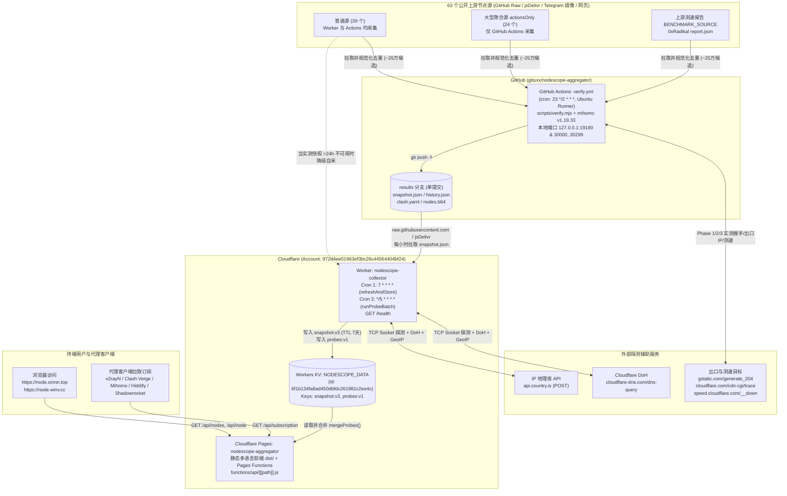

# NodeScope 技术交接手册（AGENT-HANDOFF）

> **最后核对日期**：2026-11-18（Asia/Singapore）
> **登录与凭据**：所有账号、密码、API Key、Token 见本机 `CREDENTIALS.local.md`（权限 `600`，严禁入库或写入本文档）。

---

## 1. 当前状态表（含“看起来正常、实际不正常”的隐患）

2026-11-18 线上实测数据快照（通过 `GET https://node.winv.cc/api/stats` 与 `GET https://nodescope-collector.github-972.workers.dev/health` 核实）：
- **当前在线节点数**：`3,863` 个（全部为 GitHub Actions mihomo 实测可用节点，候选池 `248,911` 个 → 本轮抽测 `70,000` 个 → 握手通过 `7,362` 个 → 二次复测通过 `7,086` 个 → 出口国家识别 `6,754` 个 → 测速完成 `6,317` 个 → Clash 格式实测通过 `6,562` 个 → 单出口 IP 限 8 节点去重后发布 `3,863` 个）。
- **上游来源数**：`63` 个配置源，`0` 个失败（`63/63` 可用）。
- **最近实测快照生成时间（`verification.generatedAt`）**：`2026-11-18T08:30:21.203Z`
- **最近 TCP 探测更新时间（`probeUpdatedAt`）**：`2026-11-18T14:10:16.508Z`（已覆盖 `3,315` 个节点入口）

### 1.1 各模块运行状态

| 模块 / 功能 | 状态 | 当前线上版本 / 部署 ID | 验证方式与说明 |
| --- | --- | --- | --- |
| 主站前端（`node.oinnn.top` / `node.winv.cc`） | ✅ 正常 | Pages 部署 `d236b022-e1fd-4896-8440-cae26a5e0601`（Git `4cb5b01`，2026-11-16） | 五语言路由（`/`、`/en/`、`/fa/`、`/ru/`、`/my/`）、搜索、筛选、分页、排序正常 |
| 软件下载目录（`/downloads/` 及多语言子路径） | ✅ 正常 | 同上 | 收录 7 款开源客户端（v2rayN、Clash Verge Rev、FlClash、Hiddify、v2rayNG、NekoBox、Karing） |
| 节点列表与统计接口（`GET /api/nodes`、`GET /api/stats`） | ✅ 正常 | 同上 | 返回脱敏元数据（剔除 `raw`、`identity`、`exitIp`、`clash`），HTTP 200 |
| 单节点 URI 复制接口（`GET /api/node?id=<id>`） | ✅ 正常 | 同上 | 支持稳定 `id` 查询，兼容旧版 `index` + `version`，返回 `Cache-Control: no-store` |
| 组合订阅接口（`GET /api/subscription`） | ✅ 正常 | 同上 | 支持 `format=base64\|plain\|clash`、`profile=all\|best100\|verified\|apac\|west\|<ISO>`，带 `Profile-Title`、UTF-8 文件名、`#备注` |
| GitHub Actions 代理实测流水线（`verify.yml`） | ⚠️ 运行成功但调度延迟高 | Workflow 运行 `#44260401010`（2026-11-18T08:30:33Z 成功） | 每次运行约 52 分钟，推送至 `results` 分支（提交 `187439e`） |
| Cloudflare 采集与探测 Worker（`nodescope-collector`） | ⚠️ 运行正常但部署时间早于 `main` HEAD | 部署于 `2026-11-04T18:36:54.953Z`（对应 Git `db555ef`） | `/health` 返回 `status: "ready"`，Cron `7 * * * *` 与 `*/5 * * * *` 正常触发 |

### 1.2 🚨 重点：“看起来正常、实际不正常”的 6 个问题

1. **GitHub Actions Cron 严重延迟导致线上每隔几小时就亮起“正在展示缓存快照”（`stale: true`）黄条**：
   - **表面现象**：GitHub Actions `Verify nodes` 每次运行都是绿色 `success`，`nodescope-collector` 的 `/health` 接口也返回 `status: "ready", stale: false`。
   - **实际问题**：`.github/workflows/verify.yml:7` 配置了 `cron: "23 */2 * * *"`（预期每 2 小时跑一次），但 GitHub 免费公共 Runner 在高负载下大幅推迟定时任务，**实测历史运行间隔为 7 小时 47 分 ～ 11 小时 57 分**。而 `functions/api/[[path]].js:13` 定义 `VERIFIED_STALE_AFTER_MS = 6 * 60 * 60 * 1000`（6 小时），`lib/feed.js:379` 定义 `VERIFIED_MAX_AGE_MS = 12 * 60 * 60 * 1000`（12 小时）。
   - **后果**：每当距离上次实测满 6 小时（几乎每个周期都会发生），前端 `/api/nodes` 就返回 `stale: true`，网页顶部出现缓存告警；一旦 GitHub Actions 延迟超过 12 小时，`fetchVerifiedSnapshot()` 会直接抛错 `快照过期或结构无效`。
2. **订阅弹窗在 Clash 格式下显示的“匹配 N 个节点”比实际导出的 Clash 节点数虚高 1%～7%**：
   - **表面现象**：`src/main.jsx:206` 写了 `if (format !== 'clash') return result.length; return result.filter((node) => node.clash !== null).length;`，看起来已经针对 Clash 格式做了过滤计数。
   - **实际问题**：`/api/nodes`（`functions/api/[[path]].js:101`）在返回节点列表给前端时执行了 `nodes.map(({ identity, raw, exitIp, clash, ...node }, index) => ...)`，**把 `clash` 字段彻底删掉了**。因此前端拿到的每个节点 `node.clash` 都是 `undefined`，`undefined !== null` 恒为 `true`。例如 `profile=best100&format=clash` 弹窗显示匹配 `100` 个节点，但实际下载 Clash 订阅时后端过滤掉 1 个 `clash: null` 节点，返回 `X-NodeScope-Count: 99`。
3. **对 `/api/*` 发送 HTTP `HEAD` 请求（如 `curl -I`）会返回 HTTP 200 `text/html` 首页，造成“接口正常但没有 API 响应头”的假象**：
   - **原因**：`functions/api/[[path]].js:49` 只导出了 `onRequestGet`，没有导出 `onRequestHead`。Cloudflare Pages 收到 `HEAD /api/stats` 时不匹配该 Function，直接回退到静态资源 `dist/index.html` 返回 200 HTML。检查 API 必须用 `GET`（`curl -s -D - -o /dev/null ...`）。
4. **波斯语（`/fa/`）、俄语（`/ru/`）、缅甸语（`/my/`）下订阅弹窗的 5 条新增提示文案显示为简体中文**：
   - **原因**：提交 `e37d054` 在 `src/i18n.js` 中新增了 `matchCount`、`noSubscriptionMatches`、`invalidSubscription`、`resetFilters`、`allCountriesSelected` 5 个翻译键，但只写入了 `zh-CN`（第 38 行）和 `en`（第 88 行）。`translate()` 函数（第 268 行）找不到对应语言键时默认回退到 `DEFAULT_LOCALE`（`zh-CN`）。
5. **新域名 `node.winv.cc` 的 HTML `<link rel="canonical">`、`og:url` 和 `sitemap.xml` 仍硬编码指向 `https://node.oinnn.top`**：
   - **原因**：静态构建脚本 `scripts/generate-locales.mjs:5` 硬编码了 `const origin = 'https://node.oinnn.top';`，`index.html:9,16,19`、`public/downloads/index.html:9,16,24`、`public/robots.txt:5` 也写死了 `node.oinnn.top`。功能不受影响，但搜索引擎抓取 `node.winv.cc` 时会将其归并为 `node.oinnn.top` 的副本。
6. **主表格地区筛选与订阅弹窗地区筛选选项不一致**：
   - **原因**：主界面节点表格的地区下拉框（`src/main.jsx:346`）只有 `all`（全部地区）、`apac`（亚太）、`west`（欧美）3 项；而订阅弹窗的地区下拉框（`src/main.jsx:370`）有 `all`、`apac`、`europe`（欧洲）、`americas`（美洲）、`west` 5 项，且主表格的 `filteredNodes`（`src/main.jsx:145-147`）不支持单独按 `europe` 或 `americas` 过滤。

---

## 2. 源代码与版本核实

- **本机目录结构**：
  - 外层工作区目录：`/Users/bb/AI-Workspace/projects/node`
  - **Git 仓库根目录（主工程目录）**：`/Users/bb/AI-Workspace/projects/node/repo`（含 `.git/`、`package.json`、`wrangler.toml` 等，所有开发与部署命令均在此目录运行）
- **Git 远程仓库**：`https://github.com/gituxx/nodescope-aggregator.git`
- **分支清单**：
  1. `main`：主源码分支。核对时无未提交代码改动，本次交接仅新增/更新交接文档与 `.gitignore` 并同步推送至 `origin/main`。
  2. `results`：GitHub Actions 实测产物分支（Orphan 单提交分支，每次由 `.github/workflows/verify.yml` 执行 `git push -f` 覆盖，不保留历史 commit 以免仓库体积膨胀）。包含：
     - `snapshot.json`：供 Cloudflare Worker 拉取的完整实测快照（含节点 `raw` URI 和 `clash` 对象）
     - `history.json`：最近 16 次滚动成功/失败记录（保留 3 天内记录），用于计算拉普拉斯平滑稳定性 `stability`
     - `stats.json`：本轮验证统计与各上游源采集计数
     - `nodes.txt` / `nodes.b64` / `clash.yaml`：全量实测节点的明文、Base64 与 Clash 配置文件
- **本地代码与线上部署一致性**：
  - **Cloudflare Pages (`nodescope-aggregator`)**：与 `main` 分支运行时代码（`4cb5b01`）**完全一致**。
  - **Cloudflare Worker (`nodescope-collector`)**：线上运行版本为 `2026-11-04T18:36:54.953Z`（对应 `db555ef`）。`db555ef` 之后至 `4cb5b01` 的提交仅在 `lib/feed.js` 中把三个地区常量拆到 `lib/regions.js` 并原样重导出，未修改 Worker 调用的 `refreshAndStore` 和 `runProbeBatch` 逻辑，因此线上行为一致；若后续修改 `lib/feed.js`、`lib/probe.js` 或 `workers/collector.js`，必须运行 `npm run deploy:collector`。

---

## 3. 系统架构



---

## 4. 核心流程与状态机

### 4.1 节点状态（`node.status`）定义与优先级

| 状态值 | UI 显示文案（中文） | 含义与判定依据 | 优先级（从高到低） |
| --- | --- | --- | --- |
| `available`（带 `verifiedAt`） | 代理实测可用 · `N ms` | 由 GitHub Actions 通过 `mihomo` 完成真实代理协议握手 + HTTP 204 测试 + 出口 IP 追踪。**最高可信度**，Cloudflare Worker 的 TCP 探测失败不会覆盖此状态（`lib/probe.js:174-175`） | 1（最高） |
| `available`（无 `verifiedAt`） | 上游测速可用 · `N ms` | 仅在降级自采模式下，匹配到 `0xRadikal` 上游 `report.json` 中 `status === "available"` 的节点 | 2 |
| `reachable` | TCP 可达 · `N ms` | 仅在节点无 `verifiedAt` 时，由 `nodescope-collector` Worker 通过 `cloudflare:sockets` 对 TCP 协议节点入口 `server:port` 建连成功（3.5 秒超时）。**仅代表入口端口开放，不代表代理握手或出口可用** | 3 |
| `failed` | 测试失败 / TCP 失败 | 仅在节点无 `verifiedAt` 时，上游 `report.json` 标记 `failed` 或 Worker TCP 建连超时/拒绝 | 4 |
| `upstream` | 上游筛选 | 仅在降级自采模式下，来自标记了 `verification: "upstream"` 的上游源且尚未被 TCP 探测覆盖 | 5 |
| `unknown`（或 `probeStatus: "unsupported"`） | 未测试 / 暂不支持测试 | 尚未轮到 TCP 探测，或属于 UDP 协议（Hysteria / Hysteria2 / TUIC / WireGuard）无法用 Cloudflare TCP Socket 判定 | 6（最低） |

### 4.2 流程一：GitHub Actions 三阶段代理实测（`scripts/verify.mjs`）
1. **全量采集与规范化去重（`collectCandidates`）**：
   - 并发（6 路）拉取 `lib/feed.js` 中的全部 `63` 个 `FEED_SOURCES`（含 `actionsOnly: true` 的大型源），支持 Base64、明文 URI、Clash YAML、HTML/RSS/Telegram 电报网页解析，自动反转义 `&amp;`。
   - 过滤私网/保留地址（`isPublicHost`）和占位符 UUID（如 `00000000-...`、`example` 等）。
   - 生成规范化 `identity`（忽略节点备注名、忽略 query 参数顺序、剔除空参数，见 `lib/feed.js`），合并重复节点并累计 `sourcesCount`，上限 `MAX_CANDIDATES = 400,000`（当前实测约 24.9 万个独立候选节点）。
2. **增量预算规划（`planRun`，默认 `--budget 70000`）**：
   - 读取上一轮 `results/history.json`，按优先级挑出本轮要测的 70,000 个节点：
     1. 最近 3 天内实测通过过的已知好节点（`good`）——每次必复测；
     2. 从未测过的新节点（`fresh`）；
     3. 距离上次测试时间最久的失败节点（`failed`，按时间戳升序轮转）。
3. **Phase 1 — Mihomo 协议握手与 URL Test（`phase1`）**：
   - 每批 `3,000` 个节点，分成每 `50` 个节点一个 `proxy-provider` 文件，启动本地 `mihomo`（控制端口 `127.0.0.1:19190`）。
   - **坏节点二分隔离（`withMihomo`）**：若某个 provider 因含非法配置导致加载节点数为 `0`，自动将该分片对半切分重启（最多 12 轮），直至把导致 mihomo 拒载的单条坏 URI 隔离丢弃。
   - 160 并发调用 `GET /providers/proxies/:provider/:name/healthcheck?timeout=6000&url=https://www.gstatic.com/generate_204`，保留延迟 `1..4000 ms` 的存活节点。
4. **Phase 2 — 真实流量出口追踪与吞吐量测速（`phase2`）**：
   - 将 Phase 1 存活节点按每批 `300` 个绑定到本地 mixed 代理端口 `127.0.0.1:30000..30299`。
   - 64 并发通过 `curl -x http://127.0.0.1:<port> https://cloudflare.com/cdn-cgi/trace` 获取真实出口 `ip` 与 `loc`（ISO 国家码）；若 trace 失败则再给一次 8 秒 URL test 机会，仍失败则淘汰。
   - 对通过节点以 16 低并发通过代理下载 `https://speed.cloudflare.com/__down?bytes=1000000`（1MB，10 秒超时），传输满 100KB 即计算 `speedMbps`。
5. **Phase 3 — Clash / Mihomo 转换格式二次验证（`phase3`）**：
   - 调用 `uriToClash(raw)` 将存活节点转为 Clash proxy 对象（剔除含 YAML 控制字符的节点），先运行 `mihomo -t` 校验配置语法（若报错 `proxy N:` 则剔除第 N 项，若报未知错误则对半切分队列），再启动 mihomo 测 `/proxies/c<index>/delay`，通过者将 proxy 对象写入 `result.clash`。
6. **质量门控、评分与单出口限流发布（`buildVerifiedSnapshot`）**：
   - 若本轮通过节点数 `< max(30, 上轮通过数 * 0.3)`（且上轮在 8 小时内），直接抛错中止发布，保护线上数据不被 Runner 网络故障清空。
   - 更新 `history.json`（保留 16 次窗口，3 天过期），计算拉普拉斯平滑稳定性 $\text{stability} = \frac{\text{ok} + 1}{\text{runs} + 2}$，综合评分 `score`（0～100 分：稳定性 50 分 + 延迟 25 分 + 速度 15 分 + 出口识别 5 分 + 多源印证 5 分）。
   - 按 `exitIp|protocol` 去重，**同一出口 IP + 协议最多保留得分最高的 8 个入口节点**（`MAX_PER_EXIT_IP = 8`），截断至最多 `MAX_NODES = 5,000` 个节点，写入 `results/` 并 `git push -f` 到 `results` 分支。

### 4.3 流程二：Cloudflare Worker 定时同步与 TCP 探测（`workers/collector.js`）
- **每小时第 7 分钟（`7 * * * *` → `refreshAndStore(env)`）**：
  - 依次从 `VERIFIED_SNAPSHOT_URLS`（GitHub Raw `results/snapshot.json`，失败回退 `cdn.jsdelivr.net`）下载实测快照。
  - 校验 `isValidVerifiedSnapshot`（生成时间在 12 小时内且节点结构完整），若比 KV `snapshot:v3` 中的版本更新则写入 KV（TTL 7 天 = `604,800` 秒）。
  - 若拉取失败：只要 KV 中已有实测快照距生成时间未超过 `24 小时`（`VERIFIED_MAX_AGE_MS * 2`），则保留旧快照并标记 `stale: true`、`refreshError`；超过 24 小时或无快照时，降级执行 `collectFeedSnapshot()`（仅拉取 39 个非 `actionsOnly` 来源）。
- **每 5 分钟（`*/5 * * * *` → `runProbeBatch(env)`）**：
  - 从 KV 读取 `snapshot:v3` 与 `probes:v1`。
  - 仅筛选 `TCP_PROTOCOLS`（`Shadowsocks`、`ShadowsocksR`、`VMess`、`VLESS`、`Trojan`）且公网域名的唯一 `server:port`，挑出未探测或探测结果超过 12 小时（`MAX_AGE_MS`）的最旧 `30` 个入口（`BATCH_SIZE = 30`），5 路并发用 `cloudflare:sockets` `connect()` 测 TCP 握手延迟（3.5 秒超时）。
  - 每轮最多对 `5` 个未知国家域名做 Cloudflare DoH A 记录解析（`DNS_BATCH_SIZE = 5`），最多对 `60` 个公网 IP 调用 `POST https://api.country.is/` 获取入口国家码（`GEO_BATCH_SIZE = 60`），清理已下线节点的缓存后写回 KV `probes:v1`。

### 4.4 流程三：Pages Functions API 请求处理（`functions/api/[[path]].js`）
1. `getFeedSnapshot(request, env)` 从 KV `snapshot:v3`（或 Worker Cache API）读取快照。若距离上次检查超过 `PAGES_RECHECK_MS`（15 分钟），Pages Function 也会尝试顺带拉取一次 `fetchVerifiedSnapshot()`。
2. `readProbes(env)` 读取 `probes:v1`，调用 `mergeProbes(snapshot.nodes, probeState)` 合并 TCP 探测与入口国家信息。
3. 根据路由分发：
   - `GET /api/nodes`：返回统计信息 + 脱敏后的 `nodes` 数组（剔除 `identity`、`raw`、`exitIp`、`clash`，附带稳定哈希 `id` 与数组下标 `index`）。
   - `GET /api/stats`：仅返回统计元数据，不含 `nodes` 数组。
   - `GET /api/node?id=<id>`（或 `?index=N&version=FETCHED_AT`）：返回单条原始节点 URI 明文（`Cache-Control: no-store`）。
   - `GET /api/subscription`：调用 `lib/subscription.js` 的 `filterSubscription(nodes, url)` 筛选并排序，再根据 `format=base64|plain|clash` 编码输出，附带 `Profile-Title`、`Content-Disposition`、`Profile-Update-Interval: 2`、`Subscription-Userinfo`、`X-NodeScope-Profile`、`X-NodeScope-Count`。

---

## 5. 代码地图

> 所有相对路径均以 `/Users/bb/AI-Workspace/projects/node/repo` 为基准。

| 文件路径 | 行数 | 职责 | 关键函数 / 常量 / DOM ID | 修改时容易出错的地方（必看） |
| --- | --- | --- | --- | --- |
| `src/main.jsx` | 427 | React 单页应用主界面（概览、节点表格、订阅配置弹窗） | `App`、`NodeRow`、`Metric`、`subscriptionUrl`、`subscriptionMatches`；弹窗元素 ID：`#modal-title`、`#subscription-region`、`#subscription-country`、`#sub-url`、`#nodes` | 1. 本地存储键为 `nodescope:subscription`（第 75、187 行），若新增筛选维度需同步更新 `resetSubscription()` 和 `useEffect` 失效清理逻辑（第 193-199 行）。<br>2. `/api/nodes` 不含 `clash` 字段，第 206 行 `node.clash !== null` 目前无法区分 `clash: null`。 |
| `src/i18n.js` | 280 | 5 种语言（`zh-CN`、`en`、`fa`、`ru`、`my`）UI 词条、SEO 元数据与路由路径辅助函数 | `LOCALES`、`DEFAULT_LOCALE`、`translate`、`getLocaleFromPath`、`getLocalePath`、`getLocalizedCountryName` | 1. 新增词条必须同时在 5 个语言对象中添加，否则缺省语言会回退显示中文。<br>2. `scripts/generate-locales.mjs` 构建时会直接 import 此文件，因此**绝不能在 `src/i18n.js` 中使用 `window` 或浏览器专属 API**。 |
| `src/style.css` | 75 | 全局样式、响应式布局、RTL（波斯语）适配与订阅弹窗样式 | `.profile-toggle`、`.format-toggle`、`.subscription-match` | 原文件第 1-37 行高度压缩在少数长行内；修改 `.profile-toggle` 列数时注意 `@media(max-width:600px)` 移动端是 3 列，桌面端 `@media(min-width:601px)` 是 5 列。 |
| `functions/api/[[path]].js` | 151 | Cloudflare Pages Functions 后端 API（`/api/nodes`、`/api/stats`、`/api/node`、`/api/subscription`） | `onRequestGet`、`nodeId`、`VERIFIED_STALE_AFTER_MS` (6h) | 1. **在 zsh 终端操作此文件必须给路径加引号 `"functions/api/[[path]].js"`**。<br>2. `/api/nodes` 必须剥离 `raw` 和 `exitIp`，防止一次性泄露全库凭据或出口 IP。<br>3. 仅导出 `onRequestGet`，不支持 `HEAD` 请求。 |
| `lib/subscription.js` | 94 | 前后端共用的订阅节点筛选、排序、各国均衡抽样与订阅备注名生成 | `filterSubscription`、`subscriptionTitle`、`PROFILE_LABELS` | **此文件被前端 `src/main.jsx` 直接打包引用，必须保持零 Node 专属依赖**。当传入的参数（如 `country` 或 `protocol`）不在当前快照集合中时，`filterSubscription` 会返回 `null`（触发 API 400）。 |
| `lib/regions.js` | 4 | 亚太（`ASIA_PACIFIC`）、欧洲（`EUROPE`）、美洲（`AMERICAS`）ISO 国家码集合 | `ASIA_PACIFIC`、`EUROPE`、`AMERICAS` | 同样被前后端共用，必须保持零依赖。 |
| `lib/feed.js` | 1230 | 63 个上游节点源定义、多格式解析器、规范化去重、实测快照拉取、KV 读写与质量门控 | `FEED_SOURCES`、`WORKER_FEED_SOURCES`、`VERIFIED_SNAPSHOT_URLS`、`VERIFIED_MAX_AGE_MS` (12h)、`parseNodeUri`、`parseFeed`、`collectCandidates`、`fetchVerifiedSnapshot`、`refreshAndStore`、`getFeedSnapshot` | 1. 大型源必须标记 `actionsOnly: true`，否则 Cloudflare Worker 降级自采时会超出 Worker 50 子请求 / CPU 时间限制。<br>2. `SNAPSHOT_KEY = "snapshot:v3"`，修改数据结构时需考虑向后兼容或升级版本号。 |
| `lib/probe.js` | 199 | Cloudflare Worker TCP 建连测试、DoH DNS 解析、`api.country.is` 地理定位与状态合并 | `TCP_PROTOCOLS`、`testTcp`、`runProbeBatch`、`mergeProbes` | 切勿把 UDP 协议加入 `TCP_PROTOCOLS`；`mergeProbes` 中 `if (verified)` 分支（第 174 行）确保代理实测结果不被 Cloudflare TCP 探测覆盖，切勿删改。 |
| `lib/clash.js` | 271 | 将各类代理 URI 转换为 Mihomo / Clash Meta proxy 对象并生成完整 Clash YAML 配置 | `uriToClash`、`buildClashConfig`、`CONTROL_CHARS` | 必须过滤控制字符（`hasControlChars`），否则生成的 YAML 会导致 Clash 客户端解析崩溃。 |
| `lib/verify.js` | 155 | 实测流水线纯函数辅助库（URI 改名、16 次滚动历史、拉普拉斯稳定性、综合评分、每出口 IP 限 8 节点） | `nodeKey`、`setUriLabel`、`updateHistory`、`stabilityOf`、`scoreNode`、`buildVerifiedSnapshot`、`MAX_PER_EXIT_IP` (8) | 纯函数模块，供 `scripts/verify.mjs` 与 `tests/verify.test.js` 调用。 |
| `scripts/verify.mjs` | 394 | GitHub Actions 节点实测主脚本（调用 `mihomo` 与 `curl` 执行 Phase 1/2/3） | `withMihomo`、`phase1`、`phase2`、`phase3`、`planRun`、`main` | 仅在 Node.js + Linux/macOS 下运行（依赖外部 `mihomo` 二进制与系统 `curl`），占用本地端口 `19190` 及 `30000..30299`。 |
| `scripts/generate-locales.mjs` | 156 | 构建后处理脚本：根据 `dist/index.html` 与 `dist/downloads/index.html` 生成 5 种语言静态 HTML 及 `dist/sitemap.xml` | `origin` (`https://node.oinnn.top`)、`localizeHome`、`localizeDownloads` | `localizeDownloads` 通过中文原文字符串精确替换（第 89-110 行）生成多语言下载页；若修改了 `public/downloads/index.html` 的中文文案，**必须同步修改此处的 `replacements` 表**。 |
| `workers/collector.js` | 42 | `nodescope-collector` Cloudflare Worker 入口（处理 `/health` 与两个 Cron 触发器） | `REFRESH_CRON` (`"7 * * * *"`)、`fetch`、`scheduled` | `REFRESH_CRON` 常量字符串必须与 `wrangler.collector.toml` 中的第一个 cron 完全一致，否则每小时刷新会被误判为 TCP probe 任务！ |
| `public/downloads/index.html` | 154 | 客户端下载页 HTML 模板（含原生 JS 平台筛选逻辑） | `.platform-button`、`[data-platforms]` | 静态模板，构建时由 `vite build` 拷入 `dist/downloads/index.html`，再由 `scripts/generate-locales.mjs` 生成各语言版本。 |
| `wrangler.toml` | 13 | Cloudflare Pages 项目配置与 `NODESCOPE_DATA` KV 绑定 | `name = "nodescope-aggregator"`、`id = "6f1b134fa8ad450dbfdc261981c2ee4c"` | Pages 与 Collector Worker 的 KV `id` 必须完全相同。 |
| `wrangler.collector.toml` | 10 | Cloudflare Collector Worker 配置、KV 绑定与 Cron 触发器 | `name = "nodescope-collector"`、`crons = ["7 * * * *", "*/5 * * * *"]` | 部署 Worker 时必须显式指定 `--config wrangler.collector.toml`。 |
| `.github/workflows/verify.yml` | 90 | GitHub Actions 定时实测并推送 `results` 分支的工作流 | `MIHOMO_VERSION: v1.19.33`、`budget: 70000` | 包含 `gh api .../enable` 保活步骤和 `results` 分支强制推送。 |
| `.github/workflows/ci.yml` | 19 | Push / PR 触发的单元测试与构建检查工作流 | `npm test`、`npm run build` | 在 Node 22 Ubuntu Runner 上运行。 |
| `tests/*.test.js` | 412 | 3 个测试文件（`feed.test.js` 240 行、`verify.test.js` 93 行、`probe.test.js` 79 行），共 20 项测试 | `node --test` | 使用 Node 内置 `node:test` 与 `node:assert/strict`，无第三方测试框架依赖。 |

---

## 6. 本地开发环境与本机环境的坑

### 6.1 本机环境参数（2026-11-18 核实）
- **操作系统**：macOS（arm64）
- **Node.js 版本**：`v24.14.0`（CI 与 Actions 使用 Node `22`，均兼容）
- **npm 版本**：`11.9.0`
- **Wrangler 版本**：`4.145.0`（项目 `devDependencies` 内置）

### 6.2 本地启动步骤
```bash
cd /Users/bb/AI-Workspace/projects/node/repo

# 1. 安装依赖（已安装，仅在 package.json 变更时执行）
npm install

# 2. 跑全量单元测试（约 100ms 跑完 20 个测试）
npm test

# 3. 方式 A：仅启动 Vite 前端热更新（端口 5173）
# ⚠️ 注意：此模式下没有 Pages Functions，前端请求 /api/nodes 会报错！仅用于调样式。
npm run dev

# 4. 方式 B：完整构建并启动 Wrangler Pages 本地服务端（默认端口 8788，含 /api/* 接口）
npm run build && npx wrangler pages dev ./dist --port 8788
```

### 6.3 本机环境的 5 个坑
1. **`npm run dev` 不带后端 API**：Vite 开发服务器不会挂载 `functions/api/[[path]].js`。要测 `/api/*` 必须用 `npm run dev:pages`（即 `npm run build && wrangler pages dev ./dist`）。
2. **本地 `wrangler pages dev` 默认使用的是本地模拟 KV**：本地空 KV 首次访问 `/api/nodes` 时，`getFeedSnapshot` 会自动从 GitHub Raw 拉取线上 `results/snapshot.json` 并写入本地模拟 KV，因此首次请求耗时约 2～5 秒，属正常现象。
3. **不要在本机用 `npx wrangler login` 交互登录**：本机无预设登录态，且在 Agent 后台任务中运行 `wrangler login` 会因等待浏览器回调 `http://localhost:8976/oauth/callback` 而超时失败。部署时直接从 `CREDENTIALS.local.md` 读取 `CLOUDFLARE_EMAIL`、`CLOUDFLARE_API_KEY`、`CLOUDFLARE_ACCOUNT_ID` 作为环境变量注入命令即可。
4. **macOS 默认 Shell 是 `zsh`，方括号路径必须加引号**：执行 `git add "functions/api/[[path]].js"` 或 `git diff "functions/api/[[path]].js"` 时若不加双引号，zsh 会报 `zsh: no matches found: functions/api/[[path]].js`。
5. **本机未安装 `./mihomo` 二进制**：`scripts/verify.mjs` 专供 GitHub Actions Ubuntu Runner 每周期运行（测试 7 万节点需 50 分钟并打开上千并发连接）。若确实需要在 macOS 本机小规模调测 `scripts/verify.mjs`，需先下载 `mihomo-darwin-arm64` 解压为 `./mihomo`，并加上 `--budget 100 --concurrency 20` 限制规模。

---

## 7. 服务器与外部资源清单（Serverless 架构）

本项目**无传统 VPS / 云服务器**，全部运行在 Cloudflare Serverless（Pages + Workers + KV）与 GitHub（Repo + Actions）上。

| 资源类别 | 名称 / 标识 | 用途 | 如何检查是否正常 | 坏了怎么修 |
| --- | --- | --- | --- | --- |
| **Cloudflare Pages** | `nodescope-aggregator`<br>（`nodescope-aggregator.pages.dev`） | 托管静态多语言网页与 `/api/*` Pages Functions | `curl -s -o /dev/null -w "%{http_code}\n" https://nodescope-aggregator.pages.dev/api/stats`（应返回 `200`） | 在 `/Users/bb/AI-Workspace/projects/node/repo` 执行 `npm run build` 后带凭据运行 `npm run deploy:cloudflare`；若最新提交有问题，在 Cloudflare Pages 控制台或 API Rollback 到上一版部署 ID `d236b022-e1fd-4896-8440-cae26a5e0601` |
| **生产自定义域名 1** | `node.oinnn.top`<br>（Zone ID: `65c7c0f9329b39ca83f0dcd9ee3a351e`） | 主站生产域名（CNAME → `nodescope-aggregator.pages.dev`，`proxied: false`） | `curl -s https://node.oinnn.top/api/stats \| head -c 120` | 检查 `oinnn.top` 的 DNS CNAME 记录是否存在，以及 Pages 项目 `domains` 列表中 `node.oinnn.top` 状态是否为 `active`（见第 11 节 API 命令） |
| **生产自定义域名 2** | `node.winv.cc`<br>（Zone ID: `6c67b3a052599b68364dacc7db6b389c`） | 主站生产域名（CNAME → `nodescope-aggregator.pages.dev`，`proxied: true`） | `curl -s https://node.winv.cc/api/stats \| head -c 120` | 检查 `winv.cc` 的 DNS CNAME 记录与 Pages 项目 `domains` 状态 |
| **Cloudflare Worker** | `nodescope-collector`<br>（`nodescope-collector.github-972.workers.dev`） | 定时拉取实测快照（`7 * * * *`）与执行入口 TCP/Geo 探测（`*/5 * * * *`） | `curl -s https://nodescope-collector.github-972.workers.dev/health \| python3 -m json.tool`（`status` 应为 `"ready"`） | 带凭据运行 `npm run deploy:collector`；若 KV 无数据，检查 GitHub `results` 分支 `snapshot.json` 是否可访问 |
| **Cloudflare Workers KV** | `NODESCOPE_DATA`<br>（ID: `6f1b134fa8ad450dbfdc261981c2ee4c`） | 存储 `snapshot:v3`（节点快照）与 `probes:v1`（TCP 探测与 IP 地理缓存） | 调用 Cloudflare KV keys API 查看是否存在 `snapshot:v3` 与 `probes:v1` | 若 `snapshot:v3` 丢失或损坏，访问一次 `https://node.winv.cc/api/stats` 会触发 `getFeedSnapshot` 自动从 GitHub `results` 分支拉取恢复 |
| **GitHub 仓库与 Actions** | `gituxx/nodescope-aggregator`<br>（`main` 分支与 `results` 分支） | 源码托管、CI 测试（`ci.yml`）与每周期真实代理测速（`verify.yml`） | `curl -s https://api.github.com/repos/gituxx/nodescope-aggregator/actions/runs?per_page=3` 查看最近运行结论是否为 `success` | 若 `verify.yml` 失败或长时间未触发，使用第 11 节命令手动发送 `workflow_dispatch` 触发一次 |
| **外部公共依赖接口** | 1. `api.country.is`<br>2. `cloudflare-dns.com/dns-query`<br>3. `www.gstatic.com/generate_204`<br>4. `cloudflare.com/cdn-cgi/trace`<br>5. `speed.cloudflare.com/__down`<br>6. `testingcf.jsdelivr.net` (Clash MMDB) | IP 归属地查询、DoH 解析、代理连通性测试、出口追踪、吞吐量测速、客户端 GeoIP 库下载 | `lib/probe.js` 与 `scripts/verify.mjs` 均内置超时与容错降级 | 若 `api.country.is` 不可用，仅影响未标记国家的入口 IP 识别，不影响已由 `cdn-cgi/trace` 识别出口国家的实测节点 |

---

## 8. 共用资源边界（严禁触碰的非本项目资源）

当前 Cloudflare 账号（`github@uxxmail.com`，Account ID `972d4ee01963ef3bc26c44564404bf24`）及域名 `oinnn.top`、`winv.cc` 下同时运行着业主的多个其他独立项目。**以下资源绝对不属于 NodeScope，在任何情况下严禁修改、覆盖、解绑或删除：**

1. **禁止触碰的其他 4 个 Cloudflare Pages 项目**：
   - `ouonnkitv`（绑定 `ouonnkitv.oinnn.top`、`ouonnkitv.winv.cc`）
   - `kvideo`（绑定 `kvideo.oinnn.top`、`kvideo.winv.cc`）
   - `tvbox-api-backup`（绑定 `tvbox.oinnn.top`、`tvbox.winv.cc`）
   - `book-oinnn-top`（绑定 `book.oinnn.top`、`book.winv.cc`）
2. **禁止触碰的其他 7 个 Cloudflare Workers**：
   - `cccat-daily-checkin`
   - `edge-mini`
   - `edgetunnel`
   - `libretv`
   - `shiying-video`
   - `winv-nav`
   - `workbuddy-checkin`
3. **禁止触碰的其他 2 个 Cloudflare KV 命名空间**：
   - `edge`（ID: `40e330af853d4e91ace657e45e3464d1`）
   - `edge-mini`（ID: `e815658f4594431fb7dc88fcda918e22`）
4. **禁止触碰的非 `node.*` DNS 记录**：
   - `oinnn.top`（Zone `65c7c0f9329b39ca83f0dcd9ee3a351e`）下的其他 25 条记录：`api-jp`、`api-us`、`bwg-la`、`cst-jp`、`gcp`、`gcp2`、`vless-a`、`vless-b`、`xhttp-a`、`xhttp-b`、`book`、`fn-sub2api`、`kvideo`、`libretv-nas`、`ouonnkitv`、`todo`、`tvbox`、`checkin`、`edgetunnel`、`edgetunnel-mini`、`libretv`、`video` 以及 Zoho 邮箱的 `MX` / `TXT (SPF)` 记录。**本项目在 `oinnn.top` 下唯一允许操作的 DNS 记录只有 `CNAME node.oinnn.top`**。
   - `winv.cc`（Zone `6c67b3a052599b68364dacc7db6b389c`）下的其他 10 条记录：`video`、`book`、`kvideo`、`music`、`ouonnkitv`、`tvbox`、`checkin`、`libretv`、`nav`、`shiying`。**本项目在 `winv.cc` 下唯一允许操作的 DNS 记录只有 `CNAME node.winv.cc`**。

---

## 9. 定时任务清单

| 任务名称 | 运行位置 / 载体 | 触发计划（Cron） | 实际执行频率与耗时 | 执行动作 |
| --- | --- | --- | --- | --- |
| **GitHub Actions 节点实测 (`Verify nodes`)** | GitHub Actions：`.github/workflows/verify.yml` | `23 */2 * * *`（配置为每 2 小时第 23 分钟）+ 支持 `workflow_dispatch` 手动触发 | 受 GitHub 免费公共 Runner 排队影响，**实际每 8～12 小时触发 1 次**，单次耗时 **50～55 分钟**（超时上限 150 分钟） | 下载 `mihomo v1.19.33`，拉取上一轮 `results` 分支历史，运行 `node scripts/verify.mjs --mihomo ./mihomo --out ./results --budget 70000`，调用 GitHub API 保活 workflow（防 60 天静默停用），将产物强制推送至 `results` 分支 |
| **Collector Worker 快照刷新** | Cloudflare Worker `nodescope-collector`（`wrangler.collector.toml`） | `7 * * * *`（每小时第 7 分钟） | 每小时准时触发，耗时 **1～3 秒** | 调用 `refreshAndStore(env)`：从 GitHub `results/snapshot.json`（或 jsDelivr 镜像）拉取最新实测快照并更新 KV `snapshot:v3`；若实测快照超过 24 小时不可用则回退 Worker 轻量自采 |
| **Collector Worker 入口 TCP 与地理探测** | Cloudflare Worker `nodescope-collector`（`wrangler.collector.toml`） | `*/5 * * * *`（每 5 分钟） | 每 5 分钟准时触发，耗时 **3～8 秒** | 调用 `runProbeBatch(env)`：对最多 30 个 TCP 协议节点入口做 `cloudflare:sockets` 建连测速，对最多 5 个域名做 DoH 解析，对最多 60 个 IP 调用 `api.country.is` 获取地理归属，结果写入 KV `probes:v1` |

---

## 10. 数据与备份

### 10.1 核心数据存储位置
本项目无关系型数据库，所有运行态数据均为可由定时任务自动再生的快照与缓存：
1. **GitHub `results` 分支**（持久化在 GitHub 远端）：
   - `snapshot.json`（约 2～3 MB）：最新一轮通过实测的节点全量数据。
   - `history.json`（约 5～15 MB）：最近 3 天内所有被测节点的 16 次滚动通过/失败记录（决定节点 `stability` 稳定性评分）。
   - `clash.yaml` / `nodes.txt` / `nodes.b64` / `stats.json`。
2. **Cloudflare KV `NODESCOPE_DATA`**（Namespace ID: `6f1b134fa8ad450dbfdc261981c2ee4c`）：
   - 键 `snapshot:v3`：当前线上 API 使用的节点快照 JSON（TTL 7 天，当前到期时间戳 `1795595422` 即 `2026-11-25T08:30:22Z`，每小时刷新自动续期）。
   - 键 `probes:v1`：Worker TCP 探测状态与 DNS/GeoIP 缓存 JSON（无固定 TTL，每次 probe 自动清理已下线节点）。

### 10.2 备份与恢复命令
修改 KV 或调整 `lib/feed.js` / `lib/probe.js` 线上结构前，先将 KV 数据与 `results` 分支备份到本地（注意备份含节点原始 URI，不要提交到 Git）：
```bash
# 1. 备份线上 KV snapshot:v3 与 probes:v1 到 /tmp
CF_EMAIL='<见CREDENTIALS.local.md>'
CF_KEY='<见CREDENTIALS.local.md>'
ACC='972d4ee01963ef3bc26c44564404bf24'
NS='6f1b134fa8ad450dbfdc261981c2ee4c'

curl -s -H "X-Auth-Email: $CF_EMAIL" -H "X-Auth-Key: $CF_KEY" \
  "https://api.cloudflare.com/client/v4/accounts/$ACC/storage/kv/namespaces/$NS/values/snapshot:v3" \
  -o /tmp/nodescope-snapshot-v3.backup.json

curl -s -H "X-Auth-Email: $CF_EMAIL" -H "X-Auth-Key: $CF_KEY" \
  "https://api.cloudflare.com/client/v4/accounts/$ACC/storage/kv/namespaces/$NS/values/probes:v1" \
  -o /tmp/nodescope-probes-v1.backup.json

# 2. 恢复备份到线上 KV（如需回滚 KV 数据）
curl -s -X PUT -H "X-Auth-Email: $CF_EMAIL" -H "X-Auth-Key: $CF_KEY" \
  -H "Content-Type: application/json" \
  "https://api.cloudflare.com/client/v4/accounts/$ACC/storage/kv/namespaces/$NS/values/snapshot:v3?expiration_ttl=604800" \
  --data-binary @/tmp/nodescope-snapshot-v3.backup.json

# 3. 备份用完后清理 /tmp 临时文件
rm -f /tmp/nodescope-snapshot-v3.backup.json /tmp/nodescope-probes-v1.backup.json
```

---

## 11. 操作手册（可直接复制执行）

> 以下所有命令中的 `<CLOUDFLARE_EMAIL>`、`<CLOUDFLARE_API_KEY>`、`<GITHUB_PAT>` 均从本机 `CREDENTIALS.local.md` 复制填入。

### 11.1 部署前端与 Pages Functions（修改 `src/`、`public/`、`functions/`、`lib/`、`scripts/generate-locales.mjs` 后执行）
```bash
cd /Users/bb/AI-Workspace/projects/node/repo
npm test
npm run build
CLOUDFLARE_EMAIL='<CLOUDFLARE_EMAIL>' \
CLOUDFLARE_API_KEY='<CLOUDFLARE_API_KEY>' \
CLOUDFLARE_ACCOUNT_ID='972d4ee01963ef3bc26c44564404bf24' \
npm run deploy:cloudflare
```

### 11.2 部署 Collector Worker（修改 `workers/collector.js`、`wrangler.collector.toml`、`lib/feed.js`、`lib/probe.js`、`lib/regions.js` 后执行）
```bash
cd /Users/bb/AI-Workspace/projects/node/repo
npm test
CLOUDFLARE_EMAIL='<CLOUDFLARE_EMAIL>' \
CLOUDFLARE_API_KEY='<CLOUDFLARE_API_KEY>' \
CLOUDFLARE_ACCOUNT_ID='972d4ee01963ef3bc26c44564404bf24' \
npm run deploy:collector
```

### 11.3 推送代码到 GitHub `main` 分支
```bash
cd /Users/bb/AI-Workspace/projects/node/repo
git -c credential.helper= \
  -c "http.https://github.com/.extraheader=AUTHORIZATION: basic $(printf 'x-access-token:<GITHUB_PAT>' | base64)" \
  push origin main
```

### 11.4 回滚线上 Cloudflare Pages 部署
如果新部署的前端或 Pages Functions 出现线上故障，可通过 Cloudflare API 一键回滚到已知正常的部署 ID（如 `d236b022-e1fd-4896-8440-cae26a5e0601`）：
```bash
CF_EMAIL='<CLOUDFLARE_EMAIL>'
CF_KEY='<CLOUDFLARE_API_KEY>'
ACC='972d4ee01963ef3bc26c44564404bf24'

# 1. 查看最近 5 次 Pages 部署记录与 ID
curl -s -H "X-Auth-Email: $CF_EMAIL" -H "X-Auth-Key: $CF_KEY" \
  "https://api.cloudflare.com/client/v4/accounts/$ACC/pages/projects/nodescope-aggregator/deployments?per_page=5" \
  | python3 -c 'import sys,json; [print(d["id"], d["created_on"], d.get("deployment_trigger",{}).get("metadata",{}).get("commit_hash")) for d in json.load(sys.stdin).get("result",[])]'

# 2. 一键回滚到指定 Deployment ID（例如 d236b022-e1fd-4896-8440-cae26a5e0601）
curl -s -X POST -H "X-Auth-Email: $CF_EMAIL" -H "X-Auth-Key: $CF_KEY" \
  "https://api.cloudflare.com/client/v4/accounts/$ACC/pages/projects/nodescope-aggregator/deployments/d236b022-e1fd-4896-8440-cae26a5e0601/rollback" \
  | python3 -m json.tool
```

### 11.4b 回滚 Collector Worker
```bash
cd /Users/bb/AI-Workspace/projects/node/repo
# 查看最近版本并回滚到上一版（wrangler 内置）
CLOUDFLARE_EMAIL='<CLOUDFLARE_EMAIL>' CLOUDFLARE_API_KEY='<CLOUDFLARE_API_KEY>' CLOUDFLARE_ACCOUNT_ID='972d4ee01963ef3bc26c44564404bf24' \
  npx wrangler deployments list --config wrangler.collector.toml
CLOUDFLARE_EMAIL='<CLOUDFLARE_EMAIL>' CLOUDFLARE_API_KEY='<CLOUDFLARE_API_KEY>' CLOUDFLARE_ACCOUNT_ID='972d4ee01963ef3bc26c44564404bf24' \
  npx wrangler rollback --config wrangler.collector.toml
# 或：git checkout <好的提交> -- workers lib && npm run deploy:collector（之后再 git checkout main -- workers lib）
```

### 11.5 手动触发 GitHub Actions 代理实测（当实测快照超过 6 小时未更新时）
```bash
GH_TOKEN='<GITHUB_PAT>'

# 1. 先检查当前是否有正在运行的 Verify nodes 任务（避免并发排队）
curl -s -H "Authorization: Bearer $GH_TOKEN" \
  "https://api.github.com/repos/gituxx/nodescope-aggregator/actions/workflows/verify.yml/runs?per_page=3" \
  | python3 -c 'import sys,json; [print(r["id"], r["status"], r["conclusion"], r["created_at"]) for r in json.load(sys.stdin).get("workflow_runs",[])]'

# 2. 若无 in_progress 任务，手动触发一次（成功返回 HTTP 204 无内容）
curl -i -s -X POST \
  -H "Authorization: Bearer $GH_TOKEN" \
  -H "Accept: application/vnd.github+json" \
  "https://api.github.com/repos/gituxx/nodescope-aggregator/actions/workflows/verify.yml/dispatches" \
  -d '{"ref":"main","inputs":{"budget":"70000"}}' | head -5
```

### 11.6 强制线上立即拉取最新 GitHub `results/snapshot.json` 到 KV
当 GitHub Actions `Verify nodes` 刚跑完生成了新的 `results/snapshot.json`，如果不想等每小时第 7 分钟的 Worker Cron，可以直接把 `results/snapshot.json` 同步进 KV `snapshot:v3`：
```bash
CF_EMAIL='<CLOUDFLARE_EMAIL>'
CF_KEY='<CLOUDFLARE_API_KEY>'
ACC='972d4ee01963ef3bc26c44564404bf24'
NS='6f1b134fa8ad450dbfdc261981c2ee4c'

curl -fsSL "https://raw.githubusercontent.com/gituxx/nodescope-aggregator/results/snapshot.json" -o /tmp/latest-snapshot.json
curl -s -X PUT -H "X-Auth-Email: $CF_EMAIL" -H "X-Auth-Key: $CF_KEY" \
  -H "Content-Type: application/json" \
  "https://api.cloudflare.com/client/v4/accounts/$ACC/storage/kv/namespaces/$NS/values/snapshot:v3?expiration_ttl=604800" \
  --data-binary @/tmp/latest-snapshot.json | python3 -m json.tool
rm -f /tmp/latest-snapshot.json
```

---

## 12. 从零重建指南（灾难恢复）

假设本机、Cloudflare 项目或 GitHub 仓库整个丢失，按以下 6 步在新环境中完整恢复：

1. **恢复代码仓库**：
   - 若 GitHub 仓库仍在：`git clone https://github.com/gituxx/nodescope-aggregator.git repo && cd repo && npm ci`
   - 若迁移到新 GitHub 仓库：修改 `lib/feed.js:374-377` 中的 `VERIFIED_SNAPSHOT_URLS` 仓库路径为新仓库的 `results/snapshot.json`。
2. **创建 Cloudflare KV 命名空间**：
   - 运行 `npx wrangler kv namespace create NODESCOPE_DATA`，将返回的 `id` 填入 `wrangler.toml`（第 8、13 行）和 `wrangler.collector.toml`（第 7 行）。
3. **触发首轮 GitHub Actions 实测生成 `results` 分支**：
   - 在 GitHub 仓库 Actions 页面启用 Workflows，手动 Run workflow `Verify nodes`（若想快速冷启动，首次可将 `budget` 填为 `10000`，约 10 分钟出结果）。
4. **创建并部署 Cloudflare Pages 项目**：
   - `npx wrangler pages project create nodescope-aggregator --production-branch=main`
   - 在 Cloudflare Pages 控制台 → `nodescope-aggregator` → Settings → Bindings 中添加 KV Namespace Binding：变量名 `NODESCOPE_DATA`，指向第 2 步创建的 KV。
   - 执行 `npm run build && npm run deploy:cloudflare`。
5. **部署 Collector Worker**：
   - 执行 `npm run deploy:collector`（自动根据 `wrangler.collector.toml` 绑定 KV 并注册 `7 * * * *` 与 `*/5 * * * *` 两个 Cron）。
6. **绑定自定义域名**：
   - 在 Cloudflare Pages `nodescope-aggregator` → Custom domains 中添加 `node.oinnn.top` 与 `node.winv.cc`，并在对应域名 DNS 下添加指向 `nodescope-aggregator.pages.dev` 的 CNAME 记录。

---

## 13. 监控体系

### 13.1 现有监控检查点
目前项目有 3 个被动健康检查接口，接手维护时可通过以下命令一键巡检：
1. **Collector Worker 健康检查**：
   - `curl -s https://nodescope-collector.github-972.workers.dev/health`
   - 正常标准：HTTP 200，`status: "ready"`，`stale: false`，`verified: true`，`count > 1000`。
2. **主站数据与陈旧度检查**：
   - `curl -s https://node.winv.cc/api/stats`
   - 正常标准：HTTP 200，`stale: false`（若 `stale: true` 说明距离 `verification.generatedAt` 已超过 6 小时或最近一次拉取报错），`refreshError: null`，`statuses.available > 1000`。
3. **GitHub Actions 实测流水线状态**：
   - 查看 `https://github.com/gituxx/nodescope-aggregator/actions/workflows/verify.yml` 最近一次运行是否为 `success`。

### 13.2 当前缺失的监控
- **无主动告警通知**：当 GitHub Actions 连续失败或 `stale: true` 超过 12 小时时，目前没有接入 Telegram Bot / 邮件 / Webhook 告警。

---

## 14. 测试体系与真实上线验证标准

### 14.1 自动化单元测试（共 20 项）
运行 `cd /Users/bb/AI-Workspace/projects/node/repo && npm test`（耗时约 0.1 秒）：
- `tests/feed.test.js`（10 项测试）：测试多协议 URI 解析、私网/脏数据过滤、Base64 订阅解码、Clash YAML 解析、规范化 `identity` 去重、API `/api/nodes` 脱敏、`/api/node` 单节点获取、`/api/subscription` 国家/地区/协议筛选、`best100` 优先级排序、`verified` 实测快照优先加载、`subscriptionTitle` 备注名生成。
- `tests/verify.test.js`（6 项测试）：测试 `setUriLabel` 改名不破坏连接参数、16 次滚动历史拉普拉斯稳定性与评分边界、`buildVerifiedSnapshot` 出口国家采用与单出口 IP 限 8 节点、吞吐量加分、`uriToClash` 协议转换。
- `tests/probe.test.js`（4 项测试）：测试 TCP 协议建连计时、UDP 协议跳过 TCP 探测并标记 `unsupported`、`mergeProbes` 不覆盖实测状态、缺失地理位置的域名/IP 批量重试与过期主机清理。

### 14.2 什么才算“真正验证通过”（上线验收必跑）
**单测通过 + `npm run build` 成功 ≠ 线上可用**。每次部署后必须跑完以下 4 条真实流量验收：
```bash
# 1. 验证双域名主页与静态资源 Hash 是否已更新为最新构建产物
curl -s https://node.oinnn.top/ | grep -o 'assets/index-[^"]*\.js'
curl -s https://node.winv.cc/ | grep -o 'assets/index-[^"]*\.js'

# 2. 验证 /api/stats 节点总数与实测时间戳
curl -s https://node.winv.cc/api/stats | python3 -c 'import sys,json; d=json.load(sys.stdin); print("count:", d["count"], "stale:", d["stale"], "generatedAt:", d.get("verification",{}).get("generatedAt"))'

# 3. 验证 Clash 组合订阅响应头（HTTP 200、Profile-Title Base64、UTF-8 文件名、实际节点数）与首行域名注释
curl -s -D /tmp/sub_h.txt "https://node.winv.cc/api/subscription?format=clash&profile=verified&country=JP&protocol=VLESS" | head -n 5
grep -iE "^HTTP|profile-title|content-disposition|x-nodescope-count" /tmp/sub_h.txt
rm -f /tmp/sub_h.txt

# 4. 验证多语言子路由与下载页可访问
for url in "https://node.winv.cc/en/" "https://node.winv.cc/fa/" "https://node.winv.cc/downloads/"; do
  echo "$url -> $(curl -s -o /dev/null -w '%{http_code}' "$url")"
done
```

---

## 15. 踩坑记录（现象 → 原因 → 解决）

以下是本项目开发与运维过程中真实踩过的 10 个坑，接手时切勿重蹈覆辙：

1. **现象**：在订阅弹窗的“国家/地区”下拉框里选择了国家，界面没有任何变化，订阅链接也没加上 `country=` 参数。
   - **原因**：旧版 UI 把下拉框做成了两步操作——先在 `<select>` 选国家存入临时 state `subscriptionCountryChoice`，还必须再点旁边的「添加」按钮才会写入 `subscriptionCountries`。用户直觉认为选中即生效。
   - **解决**：提交 `e37d054` 删除了「添加」按钮和 `subscriptionCountryChoice`，`<select onChange>` 选中后直接调用 `addSubscriptionCountry(event.target.value)` 加入已选列表并重置下拉框为空。
2. **现象**：用户把生成的订阅链接导入客户端（Clash Verge / v2rayN / Hiddify 等），客户端里的订阅备注名全部显示成网页标题 `"免费代理节点订阅与状态查询 | NodeScope"`，分不清哪个订阅是日本、哪个是 VLESS。
   - **原因**：之前 `/api/subscription` 既没返回 `Profile-Title` 响应头，前端生成的 URL 也没带 `#备注`，客户端拿不到名称就去抓站点根路径 HTML 的 `<title>`。
   - **解决**：提交 `0e06d90` 在 `lib/subscription.js` 新增 `subscriptionTitle()`，根据筛选条件生成如 `NodeScope · 实测可用 · 日本 · VLESS · Clash` 的名称，并同时通过三处下发：① 响应头 `Profile-Title: base64:...`；② 响应头 `Content-Disposition: ... filename*=UTF-8''...`；③ 前端订阅 URL 末尾追加 `#encodeURIComponent(title)`。
3. **现象**：选择范围「亚太」再选地区「欧洲」（交集为空），或从 `localStorage` 恢复了上一轮存在、本轮已下线的某小国国家码，点击打开订阅要么是 0 字节空文件，要么直接报 HTTP 400。
   - **原因**：后端 `filterSubscription` 对不存在于当前快照的国家码/协议严格校验返回 `null`（HTTP 400），对互斥地区返回空数组，而前端没有任何匹配数预览和过期选项清理。
   - **解决**：提交 `e37d054` 将 `filterSubscription` 抽到前后端共享的 `lib/subscription.js`，在弹窗实时显示“当前条件匹配 N 个节点”（0 个时橙色告警 + 一键重置），并在 `feed` 加载后自动剔除 `localStorage` 中已不在当前快照内的国家码与协议。
4. **现象**：运行 `npx wrangler login` 部署时，终端一直卡在 `Opening a link in your default browser...`，最终报错 `Timed out waiting for authorization code`。
   - **原因**：AI Agent 运行在后台子进程或远程交互受限环境中，用户无法及时在本机浏览器点击并跳回 `localhost:8976`。
   - **解决**：严禁使用 `npx wrangler login` 交互式登录，统一通过环境变量 `CLOUDFLARE_EMAIL` + `CLOUDFLARE_API_KEY` + `CLOUDFLARE_ACCOUNT_ID`（或 `CLOUDFLARE_API_TOKEN`）直接执行 `npm run deploy:cloudflare`。
5. **现象**：用 `curl -I https://node.winv.cc/api/stats` 检查接口状态，发现返回 `HTTP/2 200` 但 `content-type` 居然是 `text/html; charset=utf-8`。
   - **原因**：`functions/api/[[path]].js` 只定义了 `onRequestGet`，没有定义 `onRequestHead`。Cloudflare Pages 对未处理 `HEAD` 的路由回退返回静态 `index.html`。
   - **解决**：测试 API 严禁用 `curl -I`（HEAD），必须用 `curl -s -D - -o /dev/null`（GET）。
6. **现象**：在 macOS 终端执行 `git diff functions/api/[[path]].js` 报错 `zsh: no matches found: functions/api/[[path]].js`。
   - **原因**：zsh 默认开启 `NOMATCH` 通配符展开，把 `[[path]]` 当成了字符集 glob。
   - **解决**：所有包含 `[[path]].js` 的 shell 命令参数必须加双引号 `"functions/api/[[path]].js"`。
7. **现象**：早期 `scripts/verify.mjs` 把几千个节点放进同一个 Mihomo `proxy-provider` 测试，结果整批 3,000 个节点全部显示 0 存活。
   - **原因**：Mihomo 只要在同一个 provider 文件里遇到 1 条格式非法或字段越界的代理节点，就会拒绝加载该 provider 下的所有节点。
   - **解决**：提交 `3f6c647` 与 `2e0056d` 实现了 `withMihomo()` 分片（每 50 个节点一个 provider）+ 二分折半重试（最多 12 轮），在 Phase 3 Clash 校验中也实现了对未知配置错误分块折半隔离，并过滤掉含控制字符（`[\u0000-\u0008\u000b\u000c\u000e-\u001f\u007f]`）的节点。
8. **现象**：上游节点源 HTML/Telegram 页面里提取出的 `vless://` / `vmess://` 链接明明服务器在线，但全部握手失败。
   - **原因**：网页源中的 query 分隔符 `&` 被 HTML 转义成了 `&amp;`，导致参数名变成了 `amp;security=tls`、`amp;sni=...`。
   - **解决**：提交 `09d7391` 与 `3f6c647` 在 `lib/feed.js` 解析前统一将 URI 中的 `&amp;` 还原为 `&`。
9. **现象**：早期 `best100` 或实测列表被同一个 Cloudflare CDN 背后的几百个换壳域名（全部指向同一个出口 IP）霸榜。
   - **原因**：公开节点池中大量节点只是不同优选 IP 前置指向同一个后端代理出口。
   - **解决**：提交 `2e0056d` 在 `lib/verify.js` 中按 `exitIp|protocol` 分组，限制每个出口 IP + 协议最多保留得分最高的 8 个节点（`MAX_PER_EXIT_IP = 8`）；同时在 `lib/subscription.js` 的 `best100` 中限制单一国家最多入选 25 个节点，保证多国分布均衡。
10. **现象**：早期 `tests/feed.test.js` 中 `best100` 单测崩溃，报 `TypeError: Cannot read properties of undefined (reading 'toLowerCase')`。
    - **原因**：测试 fixture 或不完整快照中的节点缺少 `protocol` 字段，而 `filterSubscription` 直接调用了 `node.protocol.toLowerCase()`。
    - **解决**：在 `lib/subscription.js:13` 增加了防御判断 `nodes.filter((node) => typeof node.protocol === "string" && node.protocol)`。

---

## 16. 待决事项（需要业主拍板的决定）

以下事项需要业主做决定（接手 Agent 在业主拍板前保持现状，不要擅自改动）：

| 编号 | 待决问题 | 方案 A（推荐） | 方案 B | 方案 C |
| --- | --- | --- | --- | --- |
| **D1** | **已暴露的 Cloudflare Global API Key 与 GitHub Classic PAT 轮换** | **立即在控制台轮换这两个密钥**，并改用仅限本项目最小权限的 Cloudflare Scoped API Token 与 GitHub Fine-grained PAT 更新到 `CREDENTIALS.local.md`。<br>*优点*：彻底消除全账号泄露风险，且不影响线上运行。<br>*缺点*：需业主花 2 分钟登录网页操作。 | 仅重置 Global API Key 和新生成同名 Classic PAT。<br>*优点*：操作快。<br>*缺点*：权限依然过大（涵盖账号下其他 4 个 Pages 和 7 个 Worker）。 | 暂不轮换（仅在测试账号无重要资产时）。<br>*缺点*：聊天记录中的明文凭据可控制整个账号。 |
| **D2** | **GitHub Actions 定时任务每 8～12 小时才触发一次，导致满 6 小时后网页显示“正在展示缓存快照”（`stale: true`）** | **将 `functions/api/[[path]].js:13` 的 `VERIFIED_STALE_AFTER_MS` 从 6 小时调大到 12 小时，并将 `lib/feed.js:379` 的 `VERIFIED_MAX_AGE_MS` 从 12 小时调大到 18 小时**；同时在 `nodescope-collector` Worker 的每小时 Cron 中，当发现快照满 4 小时未更新时，由 Worker 自动调用 GitHub `workflow_dispatch` API 触发实测。<br>*优点*：彻底解决 GitHub cron 延迟导致的假告警，且完全免费。<br>*缺点*：需在 Worker 中配置一个仅含 `actions:write` 的 GitHub Token Secret。 | 仅调大 `VERIFIED_STALE_AFTER_MS` 到 12 小时、`VERIFIED_MAX_AGE_MS` 到 18 小时，不加 Worker 主动触发。<br>*优点*：零密钥配置，改动仅 2 行常量。<br>*缺点*：节点实测更新频率仍受 GitHub 免费 Runner 调度制约（8～12 小时一次）。 | 接入一台自有低配 Linux VPS / 自托管 GitHub Runner 跑 `verify.mjs`。<br>*优点*：可严格保证每 2 小时准时跑完。<br>*缺点*：需要额外服务器成本或占用现有 VPS 带宽。 |
| **D3** | **双域名（`node.oinnn.top` 与 `node.winv.cc`）的 SEO 主域名（Canonical / Sitemap）归属** | **保持 `node.oinnn.top` 为 SEO canonical 主域名**，`node.winv.cc` 作为对等可用镜像域名。<br>*优点*：避免搜索引擎判定双域名重复内容降权，无需改构建脚本。 | 将 `scripts/generate-locales.mjs` 中的 canonical 改为 `https://node.winv.cc`（若未来打算以 `winv.cc` 为主品牌）。 | 将 `index.html` 中的 canonical 改为由 Pages Function 动态按请求 `url.origin` 注入。<br>*缺点*：搜索引擎会收录两套完全相同的站点。 |
| **D4** | **`node.oinnn.top` 的 Cloudflare DNS 代理状态（目前为灰云 `proxied: false`，而 `node.winv.cc` 为橙云 `proxied: true`）** | **将 `node.oinnn.top` 的 CNAME 也开启橙云 `proxied: true`**，与 `node.winv.cc` 及账号下其他 Pages 域名保持一致。<br>*优点*：统一走 Cloudflare WAF 与边缘缓存策略。 | 保持现状（Pages 自定义域名无论灰云橙云均由 Cloudflare 边缘节点提供 HTTPS）。 | — |

---

## 17. 已否决的方案及原因（切勿重复尝试）

1. **❌ 在 Cloudflare Worker 中直接对全部 63 个上游源（25 万候选节点）做采集或代理协议测试**
   - **否决原因**：Cloudflare Workers 免费/标准版有严格的每次调用 **50 个子请求（subrequests）上限**、**10ms~30s CPU 时间上限**和 **128MB 内存上限**，且 Worker 的 `cloudflare:sockets` 无法运行完整的 VLESS Reality / VMess / Hysteria2 / TUIC 协议栈。因此大型源必须标记 `actionsOnly: true` 交给 GitHub Actions + `mihomo` 跑，Worker 只负责拉取 Actions 生成的 `results/snapshot.json` 和做小批量（每 5 分钟 30 个）TCP 建连辅助探测。
2. **❌ 用 Cloudflare Worker 的 TCP 探测结果覆盖已通过 `mihomo` 实测（`verifiedAt`）的节点状态**
   - **否决原因**：很多优质节点使用了 UDP 协议（Hysteria2 / TUIC），或者节点防火墙拦截了 Cloudflare 边缘 IP 的裸 TCP 连接，但通过代理协议客户端完全可用。`lib/probe.js:174` 专门加了 `if (verified)` 保护，绝不能让 TCP 探测失败把实测可用节点降级为 `failed`。
3. **❌ 在 GitHub `main` 分支或增量分支中保存每次实测的 `snapshot.json`**
   - **否决原因**：每次 `snapshot.json` + `history.json` + `clash.yaml` 约 10～20 MB，如果按常规 git commit 累加历史，几天内 Git 仓库就会膨胀到数 GB 导致 clone 和 CI 失败。因此 `.github/workflows/verify.yml:72-90` 专门采用 `git init -q -b results && git push -f` 的**单提交无历史分支**方案。
4. **❌ 把几千个候选节点写进单个 Mihomo 配置文件或单个 `proxy-provider` 一次性加载**
   - **否决原因**：公开节点池中有大量畸形 URI，Mihomo 遇到单条坏配置就会整块拒绝加载。必须保留 `scripts/verify.mjs` 中的 50 节点分片 + 二分折半隔离机制（`withMihomo`）。
5. **❌ 在订阅弹窗中保留“选择国家后再点添加按钮”的交互**
   - **否决原因**：业主明确反馈“切换国家没反应”，已改为选中即添加。
6. **❌ 自动抓取用户在 GitHub Issue 中提交的订阅 URL**
   - **否决原因**：极易被恶意提交内网探测地址（SSRF）、超大炸弹文件或带私人 token 的付费订阅导致法律与安全风险。所有节点源必须人工审核后写入 `lib/feed.js`。

---

## 18. 开发遗留资源与清理状态

| 路径 / 资源 | 来源与现状 | 是否需要清理 |
| --- | --- | --- |
| `/Users/bb/AI-Workspace/projects/node/coordination/handoffs/legacy/HANDOFF.md` | 2026-11-04 / 2026-11-05 编写的旧版单文件交接文档（位于 Git 仓库外层目录 `/Users/bb/AI-Workspace/projects/node/`） | 已由本套 4 文件体系（`AGENTS.md`、`docs/AGENT-HANDOFF.md`、`docs/项目说明.md`、`CREDENTIALS.local.md`）全面接替；旧文件保留在 `/Users/bb/AI-Workspace/projects/node/coordination/handoffs/legacy/HANDOFF.md` 仅作历史归档参考，不包含任何明文密钥 |
| `/Users/bb/AI-Workspace/projects/node/repo/CREDENTIALS.local.md`、`/Users/bb/AI-Workspace/projects/node/repo/AGENTS.md`、`/Users/bb/AI-Workspace/projects/node/repo/CHANGELOG.md`、`/Users/bb/AI-Workspace/projects/node/repo/docs/` | 仓库外层工作区的文档副本（AI 工具会自动读取工作区根目录的 `AGENTS.md`）；凭据副本权限 `600`，不在 Git 中 | 保留；**修改仓库内文档后需同步复制到外层**（`cp repo/AGENTS.md repo/CHANGELOG.md . && cp repo/docs/*.md docs/ && cp -p repo/CREDENTIALS.local.md .`） |
| `/Users/bb/AI-Workspace/projects/node/repo/.wrangler/` 与 `~/Library/Preferences/.wrangler/logs/` | Wrangler CLI 本地运行与部署产生的调试日志 | 已被 `.gitignore` 忽略；日志中不含 API Key 明文，无需特殊清理 |
| `/tmp/sub.out`、`/tmp/h.txt` | 2026-11-05 调试订阅接口时在 `/tmp` 生成的临时响应文件 | **已于 2026-11-18 核对时彻底删除** |
| 测试用 DNS 记录或临时 Cloudflare Tunnel | 本项目开发过程中**未创建**任何临时隧道或测试 DNS 记录（`node.oinnn.top` 与 `node.winv.cc` 均为正式生产记录） | 无需清理 |

---

## 19. 术语表

| 术语 / 字段名 | 含义 |
| --- | --- |
| `available`（实测可用） | 节点已通过 GitHub Actions `mihomo` 真实代理协议握手 + HTTP 204 连通性测试（或降级模式下通过上游 `0xRadikal` 测速报告验证） |
| `reachable`（TCP 可达） | Cloudflare Worker 通过 `cloudflare:sockets` 对节点入口 `server:port` 完成 TCP 三次握手，**不代表代理协议认证或出口可用** |
| `upstream`（上游筛选） | 节点来自带有 `verification: "upstream"` 标记的上游精选源，但尚未经过本项目实测 |
| `unsupported`（暂不支持测试） | UDP 协议（Hysteria / Hysteria2 / TUIC / WireGuard）或受 Cloudflare 限制的目标地址，无法使用 Worker TCP Socket 探测 |
| `actionsOnly` | `lib/feed.js` 中标记大型聚合源的布尔属性；带此标记的源仅在 GitHub Actions `verify.mjs` 中拉取，Worker 降级自采时跳过以防超时 |
| `identity` | 节点的规范化唯一身份字符串（由协议、服务器、端口、UUID/密码及排序后的非空传输参数组成，忽略节点备注名），用于跨源去重 |
| `nodeKey` / `id` | 对 `identity` 计算 SHA-1 取前 16 位十六进制（或回退模式下对 `raw` 计算 FNV-1a `f` + 8 位十六进制），作为节点的稳定 ID |
| `exitIp` / 出口 IP | 节点在 Phase 2 访问 `cloudflare.com/cdn-cgi/trace` 时测得的真实代理落地 IP（不同于节点连接入口 `server` IP）；为保护节点，`/api/nodes` 会剥离此字段 |
| `stability`（稳定性） | 基于 `results/history.json` 最近 16 次实测记录计算的拉普拉斯平滑成功率 $\frac{\text{ok}+1}{\text{runs}+2}$，范围 `0.06 ~ 0.94` |
| `score`（综合评分） | `lib/verify.js:scoreNode` 计算的 `0 ~ 100` 整数评分（稳定性占 50 分、延迟占 25 分、吞吐速度占 15 分、出口国家识别占 5 分、多源重复印证占 5 分） |
| `profile=best100` | 精选 100 订阅档位：剔除失败与未验证节点，按状态等级 → `score` 降序 → 延迟升序排列，且**每个国家最多入选 25 个节点**，最多返回 100 个节点 |
| `profile=verified` | 实测可用订阅档位：仅返回带有 `verifiedAt` 且 `status === "available"` 的全部实测节点（按 `score` 降序排列） |

---

## 20. 历史时间线与原始资料位置

### 20.1 项目演进时间线
- **2026-10-01（提交 `326d4e9` → `8767599`）**：
  - 搭建 NodeScope React + Vite 前端原型与 Cloudflare Pages 部署架构（`326d4e9`、`4411a9e`）。
  - 接入公开节点订阅源与 Cloudflare Worker (`nodescope-collector`) 定时采集 + TCP 入口探测（`a2224bf`）。
  - 完成简体中文、英语、波斯语（RTL）、俄语、缅甸语 5 种语言界面、SEO 多语言路由、客户端软件下载目录 `/downloads/` 与多语言 README（`8767599`），绑定生产域名 `node.oinnn.top`。
- **2026-11-04 ～ 2026-11-05（提交 `09d7391` → `eb2a99a`）**：
  - 新增 GitHub Actions `.github/workflows/verify.yml` 与 `scripts/verify.mjs`：引入 `mihomo` 核心对全量候选节点做真实代理握手、`/cdn-cgi/trace` 出口 IP/国家识别与 16 次滚动历史稳定性评分，结果发布至单提交 `results` 分支；清理失效源并扩充至 63 个活跃源；修复 `&amp;` 转义与规范化 `identity` 去重（`09d7391`）。
  - 实现 Mihomo provider 50 节点分片与二分折半坏节点隔离（`3f6c647`）。
  - 扩展至 25 万+ 候选池的增量 7 万预算调度（`planRun`）、新增 1MB 吞吐量测速（`speedMbps`）与 Phase 3 Clash 格式二次实测验证（`db555ef`），并部署了 `nodescope-collector` Worker。
  - Phase 3 增加未知配置错误分块折半隔离、剔除含 YAML 控制字符的节点、限制单出口 IP 最多保留 8 个节点（`2e0056d`）；修复未经过 Clash 转换测试的旧快照节点在导出 Clash 格式时被丢弃的问题（`eb2a99a`）。
- **2026-11-05 下午（提交 `e37d054` → `0e06d90`）**：
  - 优化订阅管理弹窗：国家下拉框改为选中即生效、抽取前后端共用的 `lib/subscription.js` 与 `lib/regions.js`、增加实时匹配节点数预览与一键重置、增加 `localStorage` 筛选状态持久化与失效选项自动清理、修复 Clash 格式 `X-NodeScope-Count` 计数（`e37d054`）。
  - 新增语义化订阅备注名 `subscriptionTitle()`：同时通过 `Profile-Title`（Base64）、`Content-Disposition`（UTF-8 文件名）和 URL `#备注` 下发包含具体范围、国家与协议的订阅名称（`0e06d90`）。
- **2026-11-16（提交 `4cb5b01`）**：
  - 在 Cloudflare `winv.cc` 域名下添加 `CNAME node.winv.cc -> nodescope-aggregator.pages.dev`，并在 Pages 项目绑定激活自定义域名 `node.winv.cc`。
  - 将 `functions/api/[[path]].js` 中 Clash 配置文件顶部的站点 URL 从硬编码 `https://node.oinnn.top/` 改为动态 `${url.origin}/`（`4cb5b01`），部署至 Cloudflare Pages（`d236b022`）。
- **2026-11-18**：
  - 全面核实线上 Cloudflare / GitHub / 域名 / 证书状态，编写完整交接文档体系（`AGENTS.md`、`docs/AGENT-HANDOFF.md`、`docs/项目说明.md`、`CREDENTIALS.local.md`、`CHANGELOG.md`）。

### 20.2 原始聊天记录与旧交接资料位置
- **本次会话完整原始聊天记录（JSONL Transcript）**：
  - 精简索引：`/Users/bb/.gemini/antigravity/brain/9ee81bf1-4706-451d-bedd-efea3a8bd5cf/.system_generated/logs/transcript.jsonl`
  - 完整未截断记录：`/Users/bb/.gemini/antigravity/brain/9ee81bf1-4706-451d-bedd-efea3a8bd5cf/.system_generated/logs/transcript_full.jsonl`
- **旧版交接文档（2026-11-05 归档）**：
  - `/Users/bb/AI-Workspace/projects/node/coordination/handoffs/legacy/HANDOFF.md`
