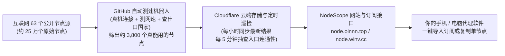

# NodeScope 项目说明（业主与非技术版）

> **2026-11-23 更新**：GitHub 仓库 gituxx/nodescope-aggregator 已按用户要求改为**私有**。私有仓库的 GitHub Actions 不再无限免费（免费额度每月 2000 分钟），而本项目测速每 2 小时一次、单次约 50 分钟，额度约 3 天耗尽，之后测速会停。正文中“公开仓库免费不限分钟”的描述已失效，处理方案待用户决定。Worker `shiying-video` 已于 2026-11-18 删除。

> **最后核对日期**：2026-11-18（Asia/Singapore）
> **账号与密钥位置**：所有登录账号、API Key、Token 均保存在本机私密文件 `CREDENTIALS.local.md` 中（未上传到网络）。

---

## 1. 这是什么、怎么用

**NodeScope** 是一个全自动运行的**公开代理节点聚合、真机测速与订阅生成网站**。它会自动从互联网上 63 个公开免费的节点源收集约 25 万个候选节点，通过真实的代理核心（Mihomo）测试哪些节点真的能连上网、识别节点的真实落地国家并测试网速，最后把大约 3,000～4,500 个真正能用的节点展示在网页上。

### 怎么访问和使用
- **主网站（两个域名完全一样，任选其一）**：
  - <https://node.oinnn.top/>
  - <https://node.winv.cc/>
- **代理客户端软件下载页**：
  - <https://node.oinnn.top/downloads/> 或 <https://node.winv.cc/downloads/>
- **日常使用三步走**：
  1. **生成订阅链接**：打开网站，点击右上角「获取订阅」（或左侧「订阅链接」），按需选择范围（如「精选 100」或「实测可用」）、想用的国家（选完即刻生效，上方会实时显示匹配了多少个节点）、协议和格式（通用客户端选 **Base64**，Clash / Mihomo 客户端选 **Clash / mihomo**），点击「复制链接」。
  2. **导入客户端**：打开你的代理软件（如 v2rayN、Clash Verge Rev、FlClash、Hiddify、Shadowrocket），粘贴订阅链接导入。客户端会自动显示清晰的订阅备注名，例如：`NodeScope · 实测可用 · 日本 · VLESS · Clash`。
  3. **或者复制单个节点**：在网页下方的节点列表里按国家、协议、延迟筛选后，点击任意节点右侧的复制图标，即可复制该节点的单条连接串。

---

## 2. 功能与支持范围（当前哪些能用、哪些有小瑕疵）

| 功能项 | 当前状态 | 详细说明 |
| --- | --- | --- |
| **双域名访问（`node.oinnn.top` / `node.winv.cc`）** | ✅ 正常可用 | 两个域名均已绑定 HTTPS 证书并指向同一套最新页面与数据 |
| **9 种主流代理协议聚合** | ✅ 正常可用 | 支持 VLESS、VMess、Shadowsocks (SS)、ShadowsocksR (SSR)、Trojan、Hysteria、Hysteria2、TUIC、WireGuard |
| **真实代理测速与出口国家识别** | ✅ 正常可用 | 后台通过 GitHub 免费算力对节点做真实连接、出口国家识别和下载测速，2026-11-18 在线实测可用节点 **3,863 个** |
| **多条件组合订阅与自动备注名** | ✅ 正常可用 | 支持按范围（全部 / 精选100 / 实测可用 / 亚太 / 欧美）、地区、多国家、多协议组合导出 Base64、原始 URI、Clash YAML，并自动生成带国家与协议名称的订阅标题 |
| **5 种语言界面切换** | ⚠️ 基本正常（小瑕疵） | 支持简体中文、英语、波斯语（从右向左排版）、俄语、缅甸语；但订阅弹窗里新加的“匹配 N 个节点 / 重置”等 5 个短语目前只翻译了中英文，在波斯语/俄语/缅甸语下会显示中文 |
| **客户端软件下载目录（`/downloads/`）** | ✅ 正常可用 | 提供 Windows、macOS、Linux、Android、iOS 下 7 款主流开源代理软件的官方 GitHub / App Store 下载入口 |
| **网页顶部偶尔出现“当前展示缓存快照”黄条** | ⚠️ 体验瑕疵（功能不断流） | 节点数据本身仍正常可用；因为 GitHub 免费定时任务排队较慢（每 8～12 小时才跑完一轮），而网页设定超过 6 小时就提示“缓存快照”，详见下方第 7 节「需要你决定的事」 |
| **Clash 格式下弹窗预览数量与实际导出数量微小偏差** | ⚠️ 体验瑕疵 | 订阅弹窗切到 Clash 格式时，显示的“匹配节点数”可能比最终下载进 Clash 的节点多 1%～7%（例如弹窗显示 100 个，实际导入 99 个），不影响使用 |

---

## 3. 简化的工作原理图

---

## 4. 用到了哪些账号和外部服务

本项目采用**纯云端无服务器（Serverless）架构**，没有购买或使用任何独立的云服务器（VPS）：

1. **Cloudflare 账号（`github@uxxmail.com`）**：
   - **Cloudflare Pages（`nodescope-aggregator`）**：托管网站网页和订阅接口。
   - **Cloudflare Worker（`nodescope-collector`）**：后台定时同步测速结果、抽查节点入口延迟。
   - **Cloudflare KV（`NODESCOPE_DATA`）**：云端数据库，存放当前可用的节点清单。
   - **Cloudflare DNS**：托管 `oinnn.top` 与 `winv.cc` 两个域名的解析和免费 SSL 证书。
   - *注意*：这个 Cloudflare 账号下还放着你的 `tvbox`、`kvideo`、`ouonnkitv`、`book`、`libretv` 等其他项目，接手人员已被严格限制只准动 `nodescope` 相关资源。
2. **GitHub 账号（`gituxx`）**：
   - **代码仓库**：`https://github.com/gituxx/nodescope-aggregator`（私有仓库，2026-11-23 起）。
   - **GitHub Actions**：使用 GitHub 免费提供的云服务器定时运行节点真机测速，并把结果存到仓库的 `results` 分支。
3. **免费免注册的外部公共接口**：
   - `api.country.is`（查询 IP 所在国家）、Cloudflare DoH / Trace / Speed（解析域名、识别节点出口 IP 和测速）、jsDelivr（GitHub 文件加速镜像）。

---

## 5. 费用清单

| 项目 | 当前费用 | 付费账号 / 归属 | 计费与续费周期 | 说明 |
| --- | --- | --- | --- | --- |
| **Cloudflare Pages / Workers / KV / SSL 证书** | **\$0（免费）** | Cloudflare (`github@uxxmail.com`) | 永久免费额度（Free Website Plan） | Pages 静态流量不限；Worker 与 KV 读写量远低于免费计划每日上限 |
| **GitHub 代码仓库与 GitHub Actions 测速算力** | **\$0（免费）** | GitHub (`gituxx`) | 永久免费（公开仓库 Public Repository） | 公开仓库使用 GitHub Actions 标准 Linux Runner 完全免费、不限分钟数 |
| **域名 `winv.cc`** | **未核实** | 注册商信息见 whois | 已续费至 **2032-08-01**（支付方式与续费价格未核实） | DNS 已托管在 Cloudflare |
| **域名 `oinnn.top`** | **未核实** | 注册商：未核实（WHOIS 隐私保护） | 已续费至 **2035-05-27**（支付方式与续费价格未核实） | DNS 已托管在 Cloudflare |
| **外部公共 API（`api.country.is` 等）** | **\$0（免费）** | 无需账号 | 免费公共服务 | 无账单 |

---

## 6. 到期日汇总表（按时间从近到远排序）

| 到期 / 关键日期 | 类别 | 具体项目 | 到期后影响 | 续期方式（自动 / 手动） |
| --- | --- | --- | --- | --- |
| **建议立即处理** | 登录凭据 | Cloudflare Global API Key 与 GitHub Classic PAT | 不会过期，但**曾在聊天记录中明文发过**，存在账号安全风险 | **需你手动操作**：去 Cloudflare 和 GitHub 后台更换（详见 `CREDENTIALS.local.md` 第 4 节） |
| **2026-11-25**（滚动 7 天） | 缓存数据 | Cloudflare KV 节点快照（`snapshot:v3`） | 若连续 7 天完全停止同步，节点列表会清空并回退实时抓取 | **全自动**：Worker 每小时刷新一次，每次自动往后顺延 7 天 |
| **2026-12-30 06:19 UTC** | SSL 证书 | `node.oinnn.top` HTTPS 证书（Google Trust Services） | 证书过期会导致浏览器打不开网站 | **全自动**：由 Cloudflare 自动免费续签，无需人工干预 |
| **每 60 天滚动** | 定时任务 | GitHub Actions `Verify nodes` 定时测速任务 | GitHub 规定仓库 60 天无提交会自动停用定时任务 | **全自动**：已在工作流中加入自动激活指令（`gh api .../enable`），每次运行自动续命 |
| **2027-02-14 06:02 UTC** | SSL 证书 | `node.winv.cc` HTTPS 证书（Google Trust Services） | 证书过期会导致浏览器打不开网站 | **全自动**：由 Cloudflare 自动免费续签，无需人工干预 |
| **2032-08-01 15:10 UTC** | 域名 | `winv.cc` 域名注册到期 | 域名失效，`node.winv.cc` 及该域名下其他子站无法访问 | **需你手动续费**：到期前在域名注册商处续费 |
| **2035-05-27 17:18 UTC** | 域名 | `oinnn.top` 域名注册到期 | 域名失效，`node.oinnn.top` 及该域名下其他子站无法访问 | **需你手动续费**：到期前在域名注册商处续费 |

---

## 7. 需要你决定的事

目前系统已经全自动稳定运行，以下 4 件事不决定也不会停服，但你可以按偏好拍板让下一个 AI 执行：

| 事项 | 现象与背景 | 方案 A（推荐） | 方案 B | 方案 C |
| --- | --- | --- | --- | --- |
| **1. 更换曾发在聊天里的两个全局 Key** | 你之前发在聊天里的 Cloudflare Global Key 和 GitHub PAT 权限覆盖整个账号（包括你的 `tvbox`、`kvideo` 等其他项目） | **去后台把旧 Key 作废，换成一个只管本项目的专用小权限 Token**（最安全，且更换时网站不会断流） | 直接在后台点重置（Roll）生成新的全局 Key 更新到 `CREDENTIALS.local.md` | 如果这只是临时测试账号、不在乎风险，可暂不处理 |
| **2. 网页每隔几小时出现“当前展示缓存快照”黄条提示** | GitHub 免费测速机器人实际每 8～12 小时才排上队跑一次，但网站设了“超过 6 小时没出新报告就亮黄条提示” | **把告警阈值从 6 小时放宽到 12 小时**，并让 Cloudflare Worker 发现超过 4 小时没更新时主动去敲一下 GitHub 触发测速（完全免费，彻底消除黄条） | 只把告警阈值从 6 小时改到 12 小时（改两行代码即可，最省事） | 挂一台你自己的小 VPS 跑测速脚本（能严格保证每 2 小时更新，但耗费 VPS 流量） |
| **3. 搜索引擎（Google/Bing）收录哪个域名为主** | 目前 `node.oinnn.top` 和 `node.winv.cc` 都能用，但网页隐藏的 SEO 标签统一写着 `node.oinnn.top` | **保持现状**（以 `node.oinnn.top` 为搜索引擎主域名，`node.winv.cc` 作备用/常用域名，避免搜索引擎判重复网站） | 改成以 `node.winv.cc` 为主域名 | 让两个域名各自独立被搜索引擎收录 |
| **4. `node.oinnn.top` 的 Cloudflare 小云朵开关** | 目前 `node.winv.cc` 开了橙色云朵代理，而 `node.oinnn.top` 是灰色云朵（仅 DNS） | **把 `node.oinnn.top` 也点亮成橙色云朵**，与你的其他子域名保持统一防护 | 保持现状（目前两者都能正常 HTTPS 访问） | — |

---

## 8. 日常维护：什么时候需要你出手？

平时**完全不需要你管**，节点采集、真机测速、淘汰死节点、证书续期全部 24 小时自动运行。只有以下 3 种情况需要你（或让 AI Agent）出手：

1. **打开网站发现节点数量变成 0，或者上方连续超过 1 天提示“数据源不可用”**：
   - 打开 `https://github.com/gituxx/nodescope-aggregator/actions/workflows/verify.yml` 看一下是不是 GitHub Actions 故障了，或者直接让 AI Agent 帮你手动触发一次测速任务。
2. **你买了新的域名，想再加一个子域名**：
   - 像这次加 `node.winv.cc` 一样，把域名托管到 Cloudflare 后告诉 AI Agent，1 分钟即可绑定好。
3. **过几个月后发现可用节点明显变少（比如跌破 500 个）**：
   - 说明网上有一批老的公开节点源停更了，让 AI Agent 巡检一下 `lib/feed.js` 里的 63 个上游源，替换掉失效源即可。

---

## 9. 风险与限制

1. **第三方公开节点的安全与隐私风险**：
   - 本站收录的所有节点均来自互联网公开免费分享，**本站不运营任何代理服务器**。免费公开节点可能被其运营者记录流量、篡改非 HTTPS 内容或随时掉线，**切勿通过这些公开节点登录网银、传输密码或处理敏感隐私数据**（网站首页与底部已内置免责声明）。
2. **平台使用条款风险（GitHub Actions & Cloudflare）**：
   - GitHub Actions 测速脚本每次会发起数万次网络连接测试节点连通性。目前单次控制在 50 分钟左右，运行在公开仓库免费额度内；请勿把并发数（`PHASE1_CONCURRENCY=160`）或单次预算（`budget=70000`）盲目调大数倍，以免触发 GitHub 滥用风控。
3. **开源许可证合规边界**：
   - 本项目自身代码采用 **MIT 许可证**。
   - 测速流水线在 GitHub Actions 运行时下载了开源的 **Mihomo（GPL-3.0 许可证）** 独立可执行程序作为命令行工具调用，**未将任何 GPL 代码合并或拷贝进本项目源码中**。后续维护时也请保持只通过命令行调用、不拷入 GPL 源码，以维持本项目的 MIT 许可证纯净性。
   - `/downloads/` 页面仅提供各开源客户端官方 GitHub Release / App Store 的外链跳转，不托管任何第三方软件安装包，无版权分发风险。

---

## 10. 相关文件的位置

| 文件 | 路径（在 `/Users/bb/AI-Workspace/projects/node/repo/` 下） | 用途 |
| --- | --- | --- |
| AI 快速入口 | [`AGENTS.md`](file:///Users/bb/AI-Workspace/projects/node/repo/AGENTS.md) | AI 接手项目第一眼看的 30 秒速览、红线与常用命令 |
| AI 详细技术手册 | [`docs/AGENT-HANDOFF.md`](file:///Users/bb/AI-Workspace/projects/node/repo/docs/AGENT-HANDOFF.md) | 完整架构图、代码地图、运维回滚命令、踩坑记录 |
| 业主项目说明（本文档） | [`docs/项目说明.md`](file:///Users/bb/AI-Workspace/projects/node/repo/docs/项目说明.md) | 非技术版功能、费用、到期日与待办事项说明 |
| 机密账号与凭据 | [`CREDENTIALS.local.md`](file:///Users/bb/AI-Workspace/projects/node/repo/CREDENTIALS.local.md) | Cloudflare 与 GitHub 的 Key / Token 及更换指南（仅存本机，不上传） |
| 变更记录 | [`CHANGELOG.md`](file:///Users/bb/AI-Workspace/projects/node/repo/CHANGELOG.md) | 历次功能修改与部署的时间线记录 |
